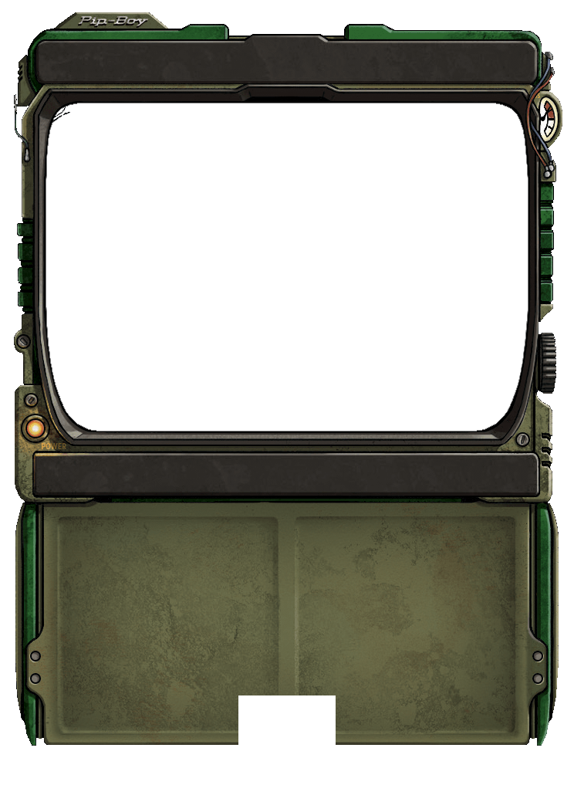

# Scorpious187's Pip Boy

A **Pip-Boy interface** for the [Fallout: The Roleplaying Game](https://foundryvtt.com/packages/fallout)
system on **Foundry VTT v13–v14**. Open it from the Token HUD to view a character's
status, inventory, data, and map on tabs — inside an authentic Pip-Boy casing,
styled after the in-game Pip-Boy from Fallout 3 / 4 / New Vegas.



---

## Installation

In Foundry: **Add-on Modules → Install Module**, and paste this manifest URL:

```
https://github.com/nscarpinatodev/scorpious187s-pip-boy/releases/latest/download/module.json
```

Then enable **Scorpious187's Pip Boy** in your world's module settings.

### Requirements

- Foundry VTT **v13+** (verified on **v14**)
- The **`fallout`** system (Fallout: The Roleplaying Game) **v11+**

---

## Opening the Pip-Boy

Select a **character** token, then click the **Pip-Boy button** in the left column
of the **Token HUD**. (You can also call `game.modules.get("scorpious187s-pip-boy").api.open(actor)`
from a macro.)

### Making it your character sheet

The Pip-Boy is also a real Foundry sheet for `character` and `robot` actors, so a
player can have it open on every click of their token or their name in the Actors
directory instead of the system sheet. Open the actor, click the **gear** in the
Pip-Boy's top bar (or in the standard sheet's window header), and choose
**Pip-Boy** in **Sheet Configuration**.

The choice is stored on the actor, so each player's own character can use a
different sheet — the module never changes the world default. The gear in the
Pip-Boy's top bar is how you switch back: the casing hides the window header the
gear usually lives in.

---

## Features

### STATUS tab
- **HP bar** with inline `−` / `+` buttons to damage or heal by 1 (clamped to max).
- **Vitals**: Defense, Initiative, Rads, Luck points, Caps, and carried weight
  (current / capacity, turns red when encumbered).
- **Condition figure** — a Vault-Boy-style body diagram (built from the fallout
  system's own limb art) that colours each limb by status: phosphor = healthy,
  amber = wounded, red = crippled.
- **Injury pips** — each limb has clickable pips that cycle
  *none → wounded → crippled*, updating the limb status and figure live.
- **S.P.E.C.I.A.L.** attributes.
- **NEEDS** — Hunger, Thirst, and Sleep shown as their descriptive levels
  (e.g. *Sated*, *Hydrated*, *Rested*) as dropdowns that update the character,
  plus Fatigue and Intoxication.
- **Action economy** — MAJOR (two dots) and MINOR (one dot) action pips that dim
  as they're spent and reset when the combat round advances, plus an **AIM**
  button. Attacking spends the major action; when none is left the Pip-Boy
  offers to buy another with AP (2 for a major, 1 for a minor).
- **FAVORITES** — weapons and consumables starred on the character sheet (or
  from the Pip-Boy's own right-click menu) get a quick-access section, split
  into WEAPONS (attack / damage) and CONSUMABLES (use).
- **POWER ARMOR** — per-location piece health with `−` / `+` and a
  POWERED / OFFLINE toggle that cascades to every attached piece.
- **RESISTANCES** — per-limb Physical / Energy / Radiation / Poison, armour
  included.
- **Right-click to edit** RADS, LUCK, CAPS, Fatigue, Intoxication, and
  power-armor piece health (LEVEL and current XP on the DATA tab).

### INV (inventory) tab
- Items grouped into **Weapons / Apparel / Aid / Ammo / Misc**, with quantity and
  weight, and a total carried / capacity readout.
- **Equip toggle** on equippable items.
- **Attack** (crosshairs) and **Damage** (burst) rolls on weapons — these open the
  fallout system's own 2d20 and combat-dice dialogs, so ammo, AP, hit locations,
  and chat cards all behave exactly like the character sheet.
- **Use** on consumables — runs the system's `consumeItem` (quantity, hunger,
  HP/rad healing, effects).
- Items with **zero quantity are hidden**.
- **ADD ITEM** opens the fallout system's own compendium browser and adds the
  chosen item straight to the character.
- **Right-click** an item for **Favorite / Unfavorite** (weapons and
  consumables), **Drop**, **Transfer**, or **Delete**.

### DATA tab
- **Level & XP**, origin.
- **Skills** — left-click a skill to roll it against its default attribute;
  **right-click** to reveal a S.P.E.C.I.A.L. picker and roll against any attribute.
- **Perks** (with rank for multi-rank perks) and **Traits**.
- **Effects** — active effects from the character and its items: temporary
  (with remaining duration), passive, and inactive.

### MAP tab
Toggle between two modes (each appears when available), with **wheel-zoom**,
**drag-pan**, and a **recentre** button:
- **World Map** — a GM-configured scene centred on a shared **party token**, tinted
  to the Pip-Boy screen colour. Re-centres live as the party token moves.
- **Local Map** — the **active scene** centred on **your** character's token.
  Shows only the scene's background art (no tokens, so no enemy positions leak).
  Re-centres as you move.

Scene tiles can be shown on either view: tick **"Show on Pip-Boy map"** in a
tile's configuration and it is drawn on the map in scene coordinates, taking the
phosphor treatment along with the scene image. Hidden tiles are never shown.

### RADIO tab
Playlists inside a playlist folder named **"Pip-Boy Radio"** (configurable)
appear as stations. Tuning a station plays it **locally only** — every player
can listen to their own station without affecting anyone else. Now-playing
readout, next-track / off buttons, and per-client **RADIO** and **SOUNDS**
volume sliders.

### Hex travel (world map)
With a **hexagonal** World Map scene, dragging the party token walks it one hex
at a time instead of teleporting: each hex advances world time and rolls for a
random encounter, and the journey stops where an encounter fires — Fallout 1's
travel map, on your Foundry canvas.

- **Party token** — Fallout 2d20 has no group actor, so **Configure World Map**
  can create one for you (an NPC-typed actor owned by all players) and record a
  **roster** of who's travelling.
- **Encounters** — a chance per hex, lowered by the party's best **Survival**
  rank. A default encounter table applies everywhere; draw a **Region** on the
  map and give it its own table to vary encounters by terrain.
- **Time** — advanced through Foundry's core clock, so any calendar module
  (Calendaria, Simple Calendar, Seasons & Stars) follows automatically.
- **Undo** — each journey's chat card carries **UNDO TRAVEL**, which puts the
  token back, rewinds the clock, and voids the encounter.

Travel needs a hexagonal grid and a GM online; without either it tells you
rather than moving untracked. Encounter tables are yours to build — the module
ships the mechanism, not the rulebooks' content.

### Scene-linked encounters
An encounter can open a **prepared scene** instead of only naming something in
chat. Build them in **Game Settings → Build Encounter Tables**: each row is a
name, a weight, a scene, and optionally a playlist, a journal entry, and GM
notes.

Entries are saved as an ordinary **Roll Table**, so weights, draw-without-
replacement, compendium export, and the per-Region overrides above all keep
working — the scene and its trimmings ride along as flags on each result.
Existing text-only tables carry on unchanged.

When a scene-linked encounter is rolled, the journey halts and the **GM** is
prompted to **Activate**, **Reroll**, or **Ignore** — players only see the
encounter card. Activating preloads the scene, activates it, optionally pulls
everyone in, starts its music, and opens its journal for the GM. A **RETURN TO
MAP** button brings the party back to the world map afterwards, with their token
still standing on the hex where they stopped.

### Custom sounds
The GM can set a **Custom Sound Folder** (in Foundry user data) holding
replacement audio for `activate.wav`, `tab.wav`, `select.wav`, `rollover.wav`,
`zoom.wav`, `radio-on.wav`, `radio-off.wav`, `light-on.wav`, `light-off.wav`,
and `close.wav`. Missing files fall back to the bundled synthesized sounds.
Provide your own files only — this module does not ship, and does not endorse
redistributing, copyrighted game audio.

### PIP-OS boot screen
Opening the Pip-Boy plays an FO3-style boot sequence on the CRT — POST
diagnostics, the PIP-OS(R) readout, and a blinking cursor — timed to the
activation sound. Click the screen to skip, or disable it per-client in
Module Settings.

### Drag & drop
Drop an Item onto the Pip-Boy — from the sidebar, a compendium, or another
sheet — and it's added to the character, exactly like dropping it on the
character sheet.

Right-click an inventory item for:
- **Drop** — places the item on the ground at your token as an **Item Pile**
  (requires the Item Piles module), backed by a single module-owned NPC actor
  so no 0 HP character actors pile up. Without a token on the scene it simply
  unequips the item instead; dropping never destroys it.
- **Transfer** — hand it to another player character (a GM must be online when
  you don't own the target).
- **Delete** — with confirmation.

### XP awards

When the GM ends a combat, the module totals the XP of every NPC and creature
that was in it and opens an award tally. The total spins up on the same
mechanical reels as the travel counter.

- Each foe is worth the reward value **the system already derives** from its
  level and category — minion, normal, mighty or legendary. There is nothing
  extra to fill in on a statblock.
- Foes marked **defeated** are ticked by default. Anything that fled, surrendered
  or was talked past can be ticked in or out, and the total re-spins.
- The award goes **full to each character** or is **split** between them; flip it
  per award, or set the default in the settings.
- A chat card records who got what, and marks anyone who has just crossed their
  next-level threshold — which is also when their **LEVEL UP** button lights up.

To open it by hand (no combat needed):
`game.modules.get("scorpious187s-pip-boy").api.awardXp()`.

### Level-up wizard

When a character's XP reaches the next threshold, a pulsing **LEVEL UP** button
appears at the top of the STATUS tab. It opens a four-step wizard drawn over the
CRT: the new level, skill ranks, a perk, then a confirmation summary. **Nothing
is written to the actor until you confirm**, and closing the wizard discards the
lot.

- **Skills** — a pool of ranks to spend freely, up to a rank cap. Both the pool
  size (default 1 per level) and the cap (default 6) are world settings. The
  **Bonus** stepper adds points for that level alone, for a feature such as
  Tag! that grants extra ranks.
- **Perks** — the whole perk list is shown, eligible ones first and locked ones
  in red with the missing requirement marked, so you can see what you are
  working towards. Level requirements, the per-rank level step for multi-rank
  perks, attribute minimums, and magazine prerequisites are all checked. Hover a perk to read it
  in the casing's lower readout. A perk the system records as restricted but
  cannot actually check — *not ghouls*, *companions only* — carries an advisory
  note instead of being hidden.
- **Max HP** rises by 1 and the wizard never writes it: the system derives max
  HP from the level. What happens to **current** HP is a setting — leave it, +1
  to match the new maximum, or heal to full as the games do.

A chat card records the level reached, the perk taken, and the skills raised.

### V.A.T.S. — damage automation
The Fallout 2d20 system rolls dice but applies nothing. **V.A.T.S.**
(Vault-Tec Assisted Targeting System) closes that gap by building on the
system's own chat cards — no system files are patched.

- **Attack cards** gain a verdict strip: successes against a difficulty that
  defaults to the **target's Defense rating** (GM-overridable per card), a
  HIT / MISS badge, and a one-click **BANK AP** for excess successes. Re-rolls
  get their own verdict and inherit the original attack's hit location.
- **Damage cards** gain an APPLY block showing the maths per target —
  `damage − DR (hit location, damage type) → final` — honouring **Piercing X**,
  **Radioactive** (rads through radiation DR), and **power-armor ablation**
  (a powered piece soaks damage before the wearer). GMs apply per target or to
  all; every application posts an outcome card with **UNDO**.
- **Consequences**: injury prompts at 5+ damage to a location or 0 HP (writing
  the right data for characters, robots, NPCs, and creatures), **Stun** as a
  status effect, and **Persistent** damage recurring at the end of the target's
  turns for the rolled number of rounds, expiring on its own.
- **Roll flow**: attacks rolled from the Pip-Boy chain straight into the damage
  dialog — and don't chain on a miss.
- **Bonus dice for AP** — attack d20s at 1 / 3 / 6 cumulative. Damage dice
  follow the rules by weapon: melee, unarmed, and thrown spend up to 3 AP at
  +1 DC each, while ranged weapons buy extra DC with **ammunition** via the
  system's Fire Rate selector. An Accurate weapon fired after **Aim** uses the
  flat AP rate instead.

### Lower readout
Clicking an item, perk, or trait (or rolling a skill) shows its **description** in
the lower panel of the Pip-Boy casing — no extra window. The panel clears when you
switch tabs or select something new.

### Presentation
- **8 frame colours** with matching CRT phosphor tint (per-client setting).
- CRT scanlines, glow, and a transparent window background so only the casing shows.
  Scanlines can be turned off per-client in Module Settings for readability.
- The **dial wheel** on the right edge of the casing opens the settings sheet.
- **Pip-Boy sounds** — activation and page-change blips (synthesized, no game
  assets); toggle per-client in Module Settings.
- **Pip-Boy light** — click the **POWER lamp** on the casing to toggle a
  10 bright / 20 dim light on your token, in Fallout Green or your screen
  colour (per-client setting). Switching it off restores the token's previous
  lighting.
- **Pip-Boy size** *(per client)* — scale the whole window and its text
  (100 / 115 / 130 / 150%), defaulting to **115%**.
- **Live updates** from the actor, its items, and token movement.
- **Per-tab scroll positions are preserved** across re-renders.

---

## Settings

Per client:
- **Pip-Boy Frame Colour** — the casing colour; the screen tint follows it.
- **Pip-Boy Size** — window and text scale (default 115%).
- **CRT Scanlines**, **PIP-OS Boot Screen**, **Pip-Boy Sounds** — toggles.
- **Pip-Boy Light Colour** — Fallout Green, or match your screen colour.

World (GM):
- **V.A.T.S. Damage Automation**, **Injury Prompts**, **Power-Armor Ablation**,
  **Auto-Roll Damage**, **Bonus Dice for AP** and its **cost model**.
- **Major / Minor Action Tracking**.
- **Award XP When Combat Ends**, and whether an award is **split between**
  the characters or given **in full to each**.
- **Level Up** — **Skill Ranks per Level** (default 1), **Skill Rank Cap**
  (default 6), **SPECIAL Cap** (default 10), and what levelling does to
  **Current HP**.
- **Pip-Boy Light** bright and dim radii.
- **Custom Sound Folder** — a folder in your user data holding replacement
  audio (see *Custom sounds* above).
- **Radio Folder** — the playlist folder whose playlists become stations.
- **World Map** — **Game Settings → Configure Settings → Scorpious187's Pip
  Boy → Configure World Map**: choose the world-map **scene**, the **party
  token** (an actor all players own), and the map **zoom**.

---

## Development

The module is plain ES modules, Handlebars templates, and CSS — no build step for
the source itself.

```powershell
# Copy the module into your local Foundry data folder for testing:
./deploy.ps1

# Package a distributable module.zip (same artifact CI produces):
./build.ps1
```

### Releasing

Pushing a version tag triggers the GitHub Actions workflow
([.github/workflows/release.yml](.github/workflows/release.yml)), which stamps
`module.json`, builds `module.zip`, and publishes a GitHub release:

```bash
git tag v0.1.0
git push origin v0.1.0
```

---

## Credits & License

Released under the [MIT License](LICENSE).

The Vault-Boy-style limb figure and the roll dialogs are provided at
runtime by the **fallout** system (Fallout: The Roleplaying Game by Muttley &
contributors); no system assets are bundled in this module. "Fallout" and
"Pip-Boy" are trademarks of Bethesda Softworks; this is an unofficial, non-
commercial fan project.
